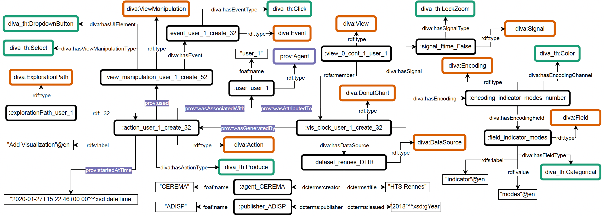

# DIVA Case Study

To demonstrate the usage of DIVA ontology, we lifted system logs describing analytical provenance information from the eSTIMe visualization system, a multi-screen visualization platform designed for exploring urban mobility data. 

## Analytical Provenance KG 

The system logs describe the exploration processes of six users, varying from 31 to 207 steps (i.e., performed actions within the visualization). Each log was recorded as a JSON array, structured sequentially to represent user interactions and the corresponding visualization states. Each log entry includes metadata such as timestamp, action type, target, view context, and descriptors of the resulting artifacts (e.g., visualizations or datasets). We used the `rdflib` library in `Python` to transform this structured JSON data into an RDF KG. The figure below shows a snipped of the generated KG.

See the [lifting](lifting) directory.

## Competency Questions

A set of competency questions were implemented through SPARQL queries and interactive visualization tools, supporting visual exploration of analytical provenance information.

See the [SPARQL Examples](sparql-examples) and [Vis](vis) directories.

