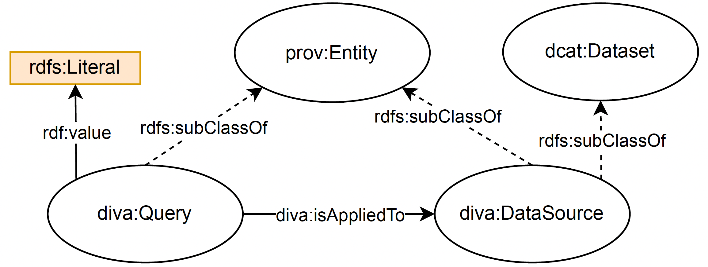
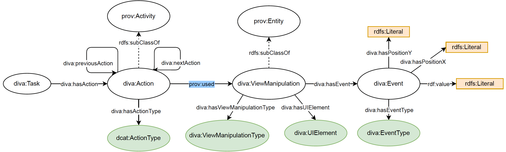
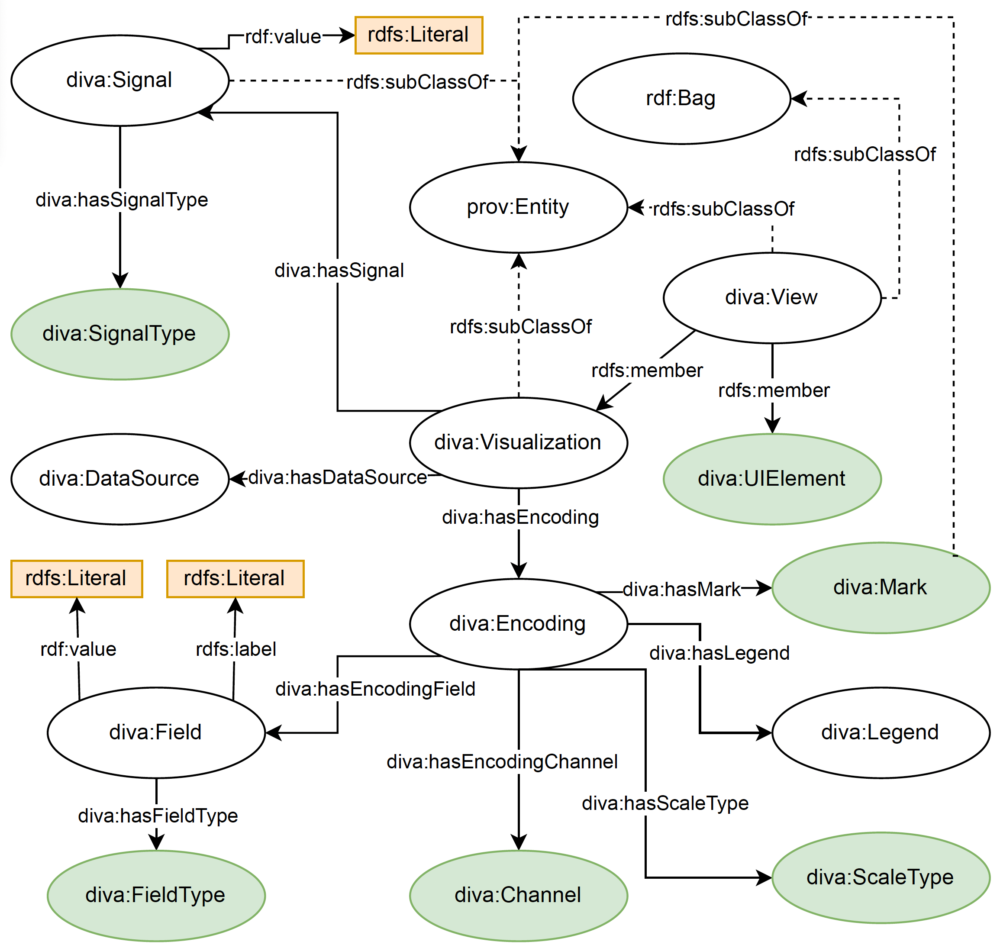
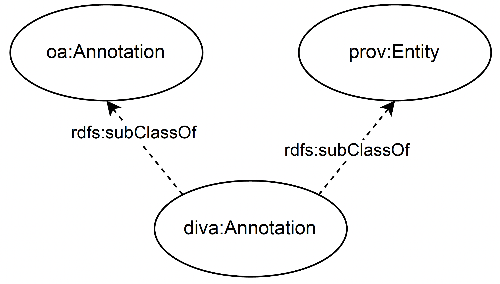
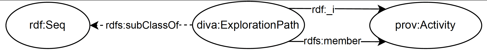

# DIVA OWL Ontology

An OWL ontology developed to represent analytical provenance across five key dimensions: **data**, **interaction**, **visualization**, **insights**, and **rationale**. It extends the [PROV-O](https://www.w3.org/TR/prov-o/) ontology, enabling comprehensive provenance tracking for a variety of resource types.

Refer to the [`diva.ttl`](diva.ttl) file for the complete ontology definition. The diagrams below illustrate the ontology’s core classes.

## Data

The `diva:DataSource` class represents the input dataset of a visualization. Using [DCAT](https://www.w3.org/TR/vocab-dcat-3/) vocabulary to describe datasets.

    

## Interaction

The `diva:Action` represents a user activity, the starting point of every user interaction with the visualization. Classes `diva:ViewManipulation` and `diva:Event` serve to describe the action taking place. It is based on taxonomies proposed by [Munzner, 2015](https://doi.org/10.1201/b17511) and [Gotz and Zhou, 2008](https://doi.org/10.1109/VAST.2008.4677365). 

## Visualization

The `diva:Visualization` class represents a visualization technique used during the exploration process. It is based on [VEGA-Lite](https://vega.github.io/vega-lite/) grammar of interactive graphics. 

## Insight and Rationale

The `diva:Annotation` class represents annotations made by users during the exploration process to express found insights or rationale leading to the adopted exploration strategy. Using the [Web Annotation](https://www.w3.org/ns/oa) vocabulary as basis.

    

## Exploration Process

Diagram representing the sequence of steps (i.e. actions) taken by a user during an exploration process.

# DIVA SKOS Thesaurus

Based on existing classifications of visualization properties, actions, view manipulations, events, and user interface (UI) elements, we created a controlled vocabulary to support sharing and comparison across visualization systems.

See the [thesaurus.ttl](thesaurus.ttl) file.